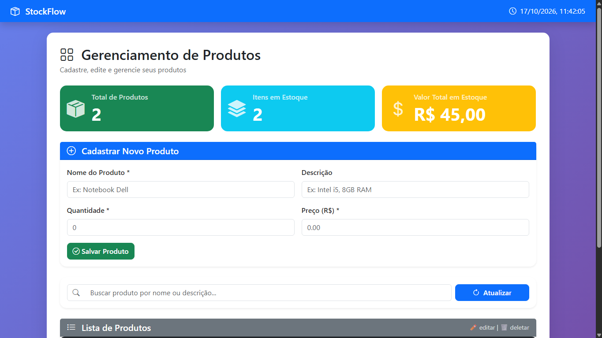

# 📦 StockFlow — Controle de Estoque Full Stack

Sistema full stack para gerenciamento de produtos desenvolvido com Python, FastAPI, PostgreSQL e JavaScript.

---

## 🚀 Tecnologias utilizadas

### Front-end
- HTML5
- CSS3
- JavaScript
- Bootstrap
- Bootstrap Icons

### Back-end
- Python
- FastAPI
- Uvicorn
- python-dotenv

### Banco de dados
- PostgreSQL (hospedado no Supabase)

---

## ✨ Funcionalidades

- ✅ Cadastro de produtos
- ✅ Listagem de produtos
- ✅ Edição de produtos
- ✅ Exclusão de produtos
- ✅ Busca em tempo real
- ✅ Dashboard com estatísticas
- ✅ API REST
- ✅ Integração com PostgreSQL
- ✅ Sistema responsivo
- ✅ Toasts de notificação
- ✅ Integração Front-end + Back-end

---

## 📸 Preview



---

## 📁 Estrutura do projeto

```text
stockflow/
│
├── backend/
│   ├── main.py
│   ├── routes.py
│   ├── database.py
│   ├── requirements.txt
│   └── .env.example
│
├── frontend/
│   ├── index.html
│   ├── css/
│   ├── img/
│   └── js/
│
├── .gitignore
└── README.md
```

---

## ⚙️ Como rodar o projeto

### 1. Clone o repositório

```bash
git clone https://github.com/JhonatanResende/stockflow.git
```

### 2. Entre na pasta backend

```bash
cd backend
```

### 3. Crie e ative o ambiente virtual

```bash
python -m venv venv

# Windows
venv\Scripts\activate

# Linux/Mac
source venv/bin/activate
```

### 4. Instale as dependências

```bash
pip install -r requirements.txt
```

### 5. Configure o arquivo `.env`

Crie um arquivo `.env` dentro da pasta `backend` baseado no `.env.example`:

```env
DB_HOST=aws-0-sa-east-1.pooler.supabase.com
DB_USER=postgres.seu_usuario_supabase
DB_PASSWORD=sua_senha
DB_NAME=postgres
DB_PORT=5432
```

### 6. Configure o banco de dados

No Supabase, acesse o **SQL Editor** e execute:

```sql
CREATE TABLE produtos (
    id            SERIAL PRIMARY KEY,
    nome          VARCHAR(255)  NOT NULL,
    descricao     TEXT,
    quantidade    INTEGER       NOT NULL DEFAULT 0,
    preco         DECIMAL(10,2) NOT NULL DEFAULT 0.00,
    data_cadastro TIMESTAMP     NOT NULL DEFAULT CURRENT_TIMESTAMP
);
```

### 7. Rode o servidor

```bash
uvicorn main:app --reload
```

Servidor rodando em `http://localhost:8000`

### 8. Abra o front-end

Abra o arquivo `frontend/index.html` no navegador ou use a extensão Live Server do VS Code.

---

## 📡 Rotas da API

| Método | Rota              | Descrição         |
|--------|-------------------|-------------------|
| GET    | /api/produtos     | Listar produtos   |
| GET    | /api/produtos/:id | Buscar produto    |
| POST   | /api/produtos     | Criar produto     |
| PUT    | /api/produtos/:id | Atualizar produto |
| DELETE | /api/produtos/:id | Deletar produto   |

---

## 🔒 Variáveis de ambiente

Este projeto utiliza variáveis de ambiente com `.env`. O arquivo `.env` não deve ser enviado para o GitHub — use o `.env.example` como base.

---

## 🛠️ Dependências principais

- fastapi
- uvicorn
- psycopg2-binary
- python-dotenv

---

## 🌐 Deploy

- **Sistema:** https://stockflow-1-seven.vercel.app/
- **API:** https://stockflow-api-uo5d.onrender.com

---

## 👨‍💻 Autor

Desenvolvido por Jhonatan Resende 🚀